# Vidro

**Um visual de vidro translúcido para o KDE Plasma 6 — e um app para ajustar cada detalhe dele.**

Janelas com cantos arredondados e botões no estilo semáforo, sombras suaves, animações próprias, ícones minimalistas, telas de login e de bloqueio combinando (com foto, papel de parede ou **vídeo**), estúdio de cursores, sons do sistema, NotepadK (um bloco de notas sem distrações) — e tudo isso com liga/desliga e controles deslizantes no app **Configurações do Vidro**, cada aba com um exemplo que muda na hora.

*Code and commands are in English; the interface and docs are in Brazilian Portuguese. [English summary at the end.](#english-summary)*


## Instalação rápida

**Pelo terminal** (baixa a versão mais nova e abre o instalador com janela para escolher os extras):

```bash
bash <(curl -fsSL https://github.com/pznp-ia/vidro-kde/releases/latest/download/install-vidro.sh)
```

Tudo de uma vez, sem perguntas: `bash <(curl -fsSL https://github.com/pznp-ia/vidro-kde/releases/latest/download/install-vidro.sh) --all`

**Pela interface (sem terminal):**
1. Baixe o **[install-vidro.sh](https://github.com/pznp-ia/vidro-kde/releases/latest/download/install-vidro.sh)**;
2. no Dolphin: clique direito nele → **Propriedades → Permissões → marque "É executável"**;
3. clique duas vezes nele → **Executar**. Abre a janela do instalador.

Depois: **saia e entre de novo** na sessão. Para atualizar: `vidro-update` ou a aba **Atualizações** do app. Outras formas (pacotes .deb/.rpm, Arch, código-fonte): [Instalar](#instalar).

---

## Sumário

- [Instalação rápida](#instalação-rápida)
- [Configurações do Vidro (o app)](#configurações-do-vidro)
- [Tudo o que dá para ajustar](#tudo-o-que-dá-para-ajustar)
  - [Geral](#geral) · [Janelas](#janelas) · [Aplicativos](#aplicativos) · [Área de trabalho](#área-de-trabalho) · [Sistema](#sistema)
- [Instalar](#instalar) · [Atualizar](#atualizar) · [Linha de comando](#linha-de-comando) · [Desinstalar](#desinstalar)
- [Observações](#observações) · [Problemas conhecidos](#problemas-conhecidos) · [Licença](#licença)

---

## Configurações do Vidro

Abra pelo menu de apps (**Configurações do Vidro**) ou com o **clique direito no widget** de transparência. A lateral é dividida em grupos — Geral, Janelas, Aplicativos, Área de trabalho e Sistema — e cada aba tem:

- um **exemplo desenhado em cima do seu papel de parede**, que muda na hora em que você mexe;
- um **liga/desliga** do recurso e **controles deslizantes** para as medidas;
- valores que começam iguais ao que você já tem: nada muda até você mexer.


As configurações ficam em `~/.config/vidrorc`; também dá para usar o terminal ([veja abaixo](#linha-de-comando)).

---

## Tudo o que dá para ajustar

### Geral

| Aba | O que tem |
|---|---|
| **Perfis** | Salvar o visual inteiro com um nome, carregar (o visual de agora é guardado antes como "auto-…"), apagar, **exportar e importar** para compartilhar. |

### Janelas

| Aba | O que tem |
|---|---|
| **Janelas** | Decoração de vidro (Aurorae) com cantos arredondados; transparência da janela ativa e das inativas; cor da barra de título que **acompanha o brilho do papel de parede** (escura ou clara); sombra gaussiana suave, sem emendas. |
| **Botões das janelas** | Lado (esquerda/direita), ordem (macOS/Windows), botão de menu, **6 estilos** (semáforo, com símbolos, grafite, contorno, só ícones, quadrados), tamanho, espaço, uma cor para cada botão, cor nos inativos, quando mostrar os símbolos, espessura e efeito ao passar o mouse. |
| **Animações** | Abrir, fechar, minimizar (a janela **viaja até o ícone**), maximizar e mostrar área de trabalho — cada uma com estilo e duração; curva (suave, ágil, mola) e velocidade geral do KDE. Botão "Testar" no exemplo. |

| | |
|---|---|
| 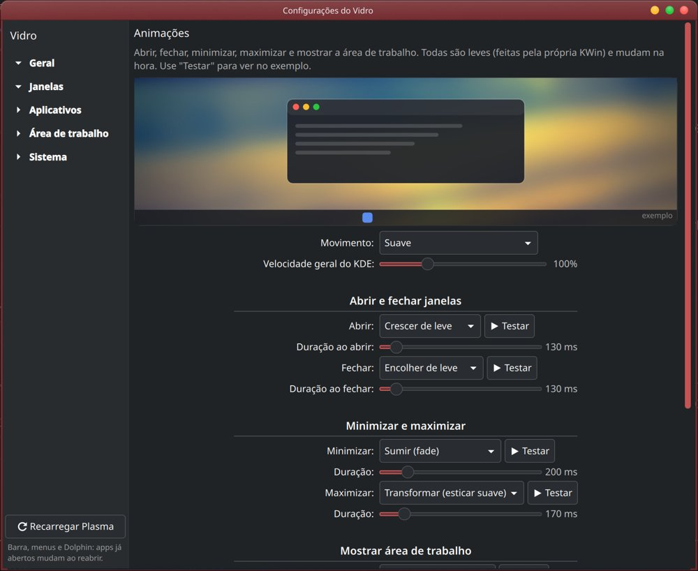 | 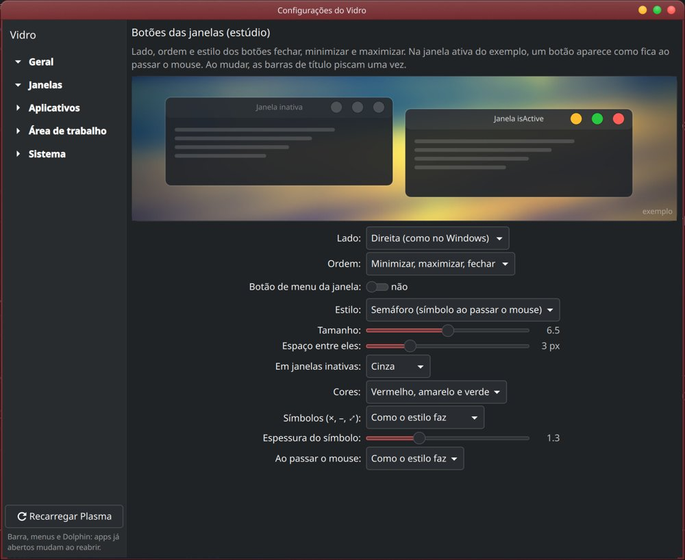 |
| **Animações** | **Estúdio dos botões** |

### Aplicativos

| Aba | O que tem |
|---|---|
| **Estilo dos aplicativos** | Estúdio para os apps do KDE (estilo [Union](https://invent.kde.org/plasma/union)): botões (vidro, planos, contorno, preenchidos), campos, caixas de seleção, abas, seleção nas listas, foco, cantos e espaçamento. |
| **Barra de rolagem** | Fina, de vidro, **por cima do conteúdo** e some quando parada (como no macOS); estilos vidro, neon fino ou cor escolhida; largura, tempo para sumir. |
| **Menus (clique direito)** | Cantos, opacidade, espaçamento, realce e animação de abrir/fechar. |
| **Cores** | Cor de destaque e cor da fonte. |
| **Dolphin** | Sem linhas entre as partes, área de arquivos na cor da interface. |
| **Versão clara** *(teste)* | As mesmas transparências com cores claras. |
| **EditorKden** | Atalho para o Kdenlive (flatpak) com visual minimalista: abas em pílula, botões planos, ferramenta ativa na cor de destaque; esconder menu/barra de status; cores dos clipes e da forma de onda. O Kdenlive normal não muda. |
| **NotepadK** | Veja [NotepadK](#notepadk) abaixo. |

| | |
|---|---|
| 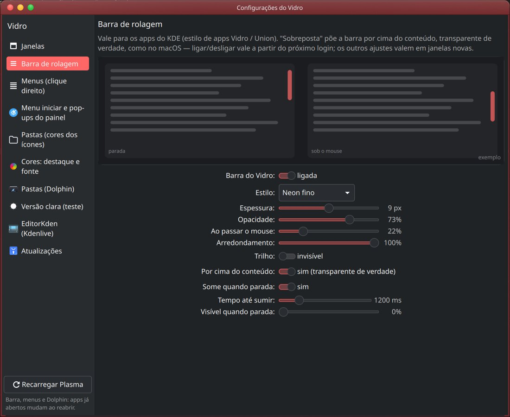 | 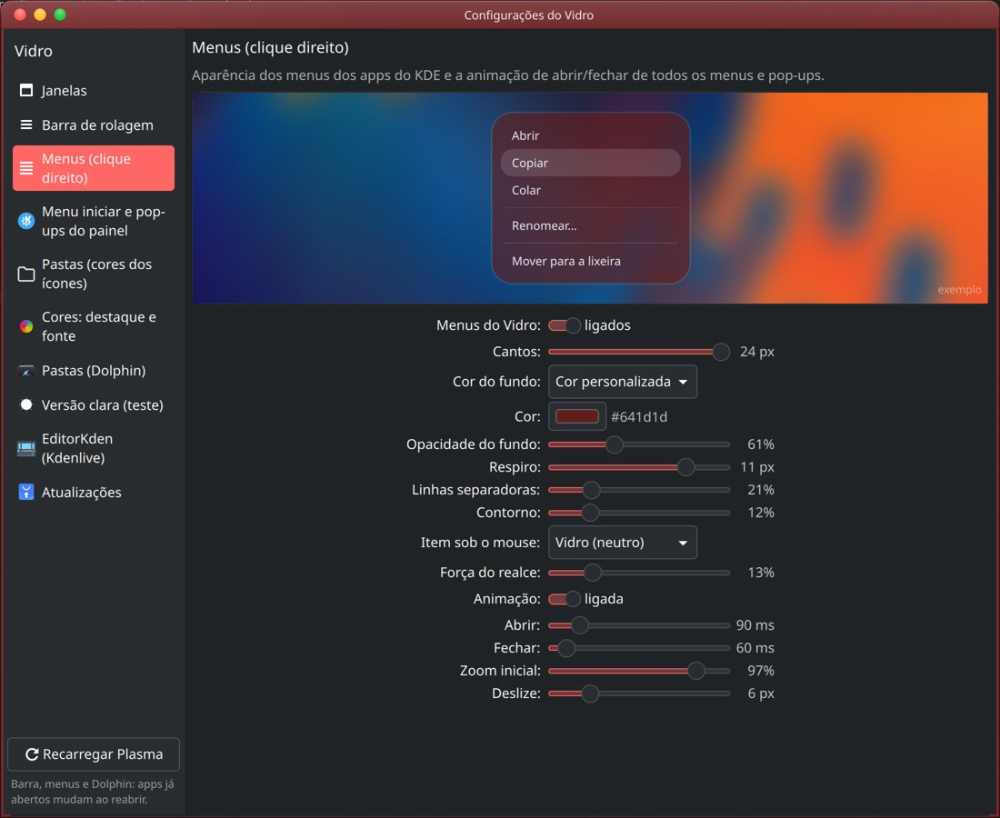 |
| **Barra de rolagem** | **Menus** |
| 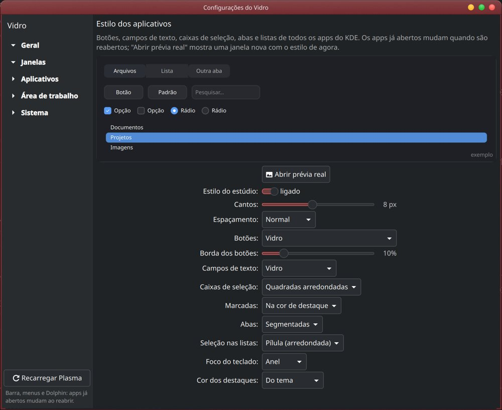 |  |
| **Estilo dos aplicativos** | **Dolphin** |

#### NotepadK

Um bloco de notas feito sobre o Kate. No **modo foco** a janela vira só a folha — sem barras, menus nem números de linha — com uma faixa invisível no topo para arrastar (clique duplo maximiza). **Ctrl+Shift+Espaço** (ou o botão no canto) traz a interface completa com uma transição suave. O seu Kate normal não muda.

- **Texto:** fonte, tamanho, cores (automático claro/escuro, Breeze, Nord, Dracula, Monokai, Solarized, GitHub), espaço entre linhas, quebra de linha.
- **Bloco de texto:** margens dos lados e em cima/embaixo, **coluna centralizada** (largura em letras), destaque leve da linha atual, **rolagem de máquina de escrever** (o cursor fica perto do meio), contador de palavras discreto.
- **Janela:** opacidade, barra de título no modo foco, sempre no topo, botão flutuante e sua opacidade.
- **Animações:** troca foco ↔ interface por esmaecer, deslizar, zoom ou nenhuma; curva (suave, rápida, elástica, linear); duração; o texto aparece suavemente ao abrir.

| | |
|---|---|
| 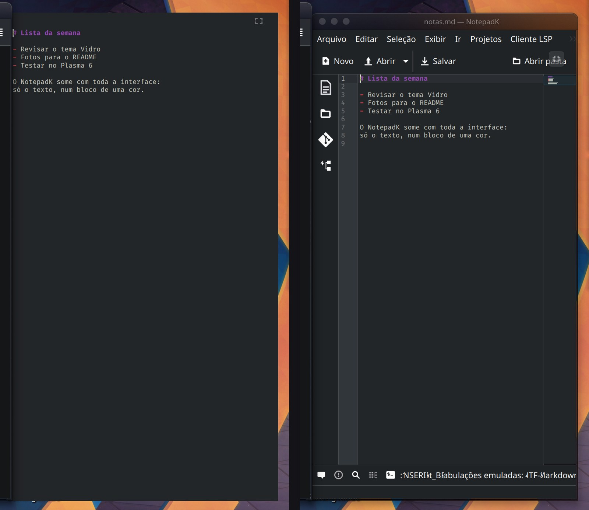 | 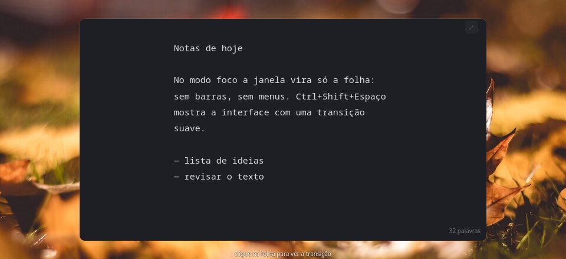 |
| **Modo foco e interface completa** | **Coluna centralizada, linha atual e contador de palavras** |

### Área de trabalho

| Aba | O que tem |
|---|---|
| **Menu iniciar: tipo e opções** | Kickoff, menu clássico ou tela cheia (troca no mesmo lugar); grade ou lista, compacto, categorias à direita, trocar categoria ao passar o mouse, rodapé, nomes nos botões, formato do nome, ordem alfabética, ícone e texto do botão. |
| **Menu iniciar e pop-ups do painel** | Fundo de vidro com cantos, opacidade, contorno, sombra; animação própria (sobe direto, opaco). |
| **Barra de tarefas e relógio** | Altura, flutuante, posição, largura (tela toda ou estilo dock), alinhamento, esconder; **vidro próprio da barra** (cantos, opacidade, contorno, sombra, cor); ícones dos apps (espaço, agrupar, só da área atual, som, prévias, realce, clique do meio, linhas); relógio (segundos, 12/24 h, data e formato, negrito, tamanho); ícone do "mostrar área de trabalho". |
| **Barra: aparecer e sumir** | Animação da barra quando ela se esconde sozinha: estilo ao **aparecer** e ao **sumir** (deslizar da borda, esmaecer, deslizar + esmaecer, encolher/crescer, subir crescendo, nenhuma), duração de cada um, curva, distância do deslize e tamanho inicial. |
| **Ícones de arquivos** | Papel escuro, claro, colorido pelo tipo ou plano; etiqueta da extensão; canto dobrado; cantos. |
| **Ícones da lateral (Dolphin)** | Linha, preenchido ou colorido por local; cor, espessura, tamanho. |
| **Pastas** | Grafite, cor de destaque ou qualquer cor. |
| **Estúdio do cursor** | Veja [Estúdio do cursor](#estúdio-do-cursor). |
| **Mouse** | Veja [Mouse](#mouse). |
| **Tela de login** | Veja [Telas de login e de bloqueio](#telas-de-login-e-de-bloqueio). |

| | |
|---|---|
|  | 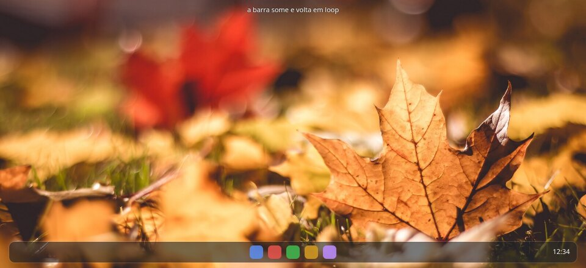 |
| **Menu iniciar e pop-ups** | **Barra: aparecer e sumir** (exemplo em loop) |
| 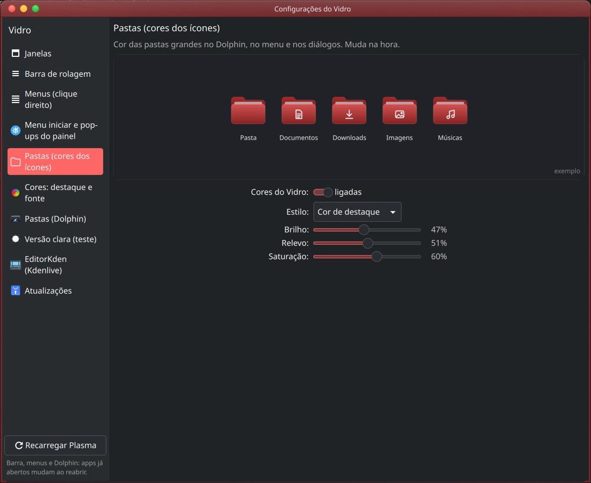 |  |
| **Cores das pastas** | **Dolphin com o Vidro** |

#### Telas de login e de bloqueio

A tela de login (SDDM) e a de bloqueio (**Win+L**) usam o mesmo visual, montado na aba **Tela de login**:

- **Fundo:** Honeywave, o seu papel de parede atual, **uma galeria com os papéis de parede instalados** (miniaturas clicáveis), **qualquer foto** sua, **um vídeo** (em loop, sem som, com velocidade ajustável) ou cor lisa; desfoque e força do desfoque; escurecer.
- **Relógio:** mostrar, 24 h ou 12 h, segundos, tamanho, espessura da letra, data.
- **Senha e avatar:** posição (centro ou esquerda), cor de destaque, vidro dos campos, foto do usuário (círculo ou quadrado), fonte.
- **Tela de bloqueio igual à de login** (liga/desliga). A transição do relógio entre a tela parada e a caixa de senha é um movimento só, junto com o desfoque.
- **Prévia em janela** (redimensionável; **Esc 3 vezes** fecha) e **"Aplicar na tela de login"** (pede a senha de administrador). Opção de pedir a senha ao ligar (desliga o login automático).

| | |
|---|---|
| 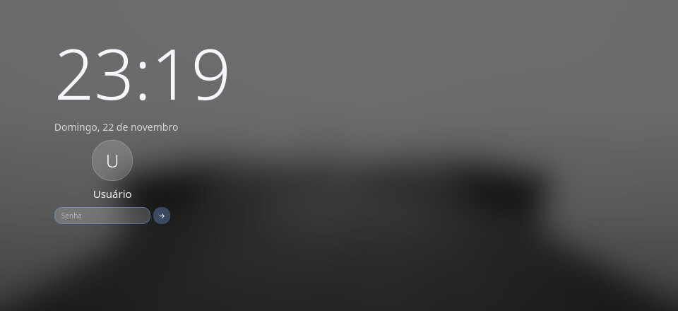 |  |
| **Estúdio da tela de login** | **Tela de bloqueio** |

#### Estúdio do cursor

Gera um tema de cursores completo (47 formas + todos os nomes do Breeze, em SVG e Xcursor):

- 4 formas de seta, cor de dentro, cor do contorno, cor dos detalhes (espera, selos), espessura do contorno, cantos arredondados, sombra, tamanho; modelos prontos; área para testar cada cursor; desligar volta ao cursor que você usava.
- **Importar desenhos:** troque a seta, a mão, o texto, a espera, o proibido, o mover e a mira por um **SVG** seu ou por **cursores do Windows (.ico/.cur)**. Com "Cores do estúdio" **o editor trabalha em cima do desenho** (cores, contorno, cantos e sombra); com "Cores originais" ele fica como está. Arquivos .cur trazem o próprio ponto de clique; nos outros você escolhe (automático, canto, topo, centro). A seta importada também vale para copiar, ajuda, ocupado etc.

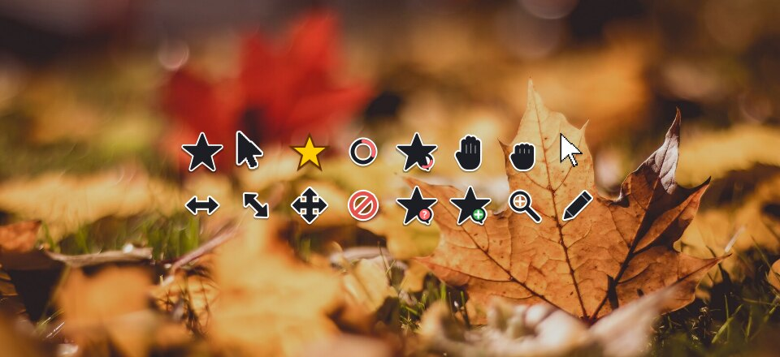

<sub>Exemplo: estrela (SVG) e seta (.cur) importadas com as cores do estúdio; outra estrela e uma seta .ico com as cores originais.</sub>

#### Mouse

Velocidade e aceleração (constante ou adaptativa), canhoto, clique do meio com esquerdo + direito, velocidade da rodinha, linhas por passo, rolagem natural, tempo do clique duplo (com área de teste); touchpad (tocar para clicar, rolagem natural, velocidade); **achar o cursor** (sacudir para crescer, mostrar cliques, esconder parado ou ao digitar). Vale na hora para todos os mouses conectados.

### Sistema

| Aba | O que tem |
|---|---|
| **Sons do sistema** | Liga/desliga, som ao mudar o volume; **todos os temas instalados** em cartões com ▶ para ouvir cada evento; o conjunto **Vidro** (sons minimalistas feitos por síntese, com entrada e saída no clima dos anos 90); **Meu preset** (tema base + um som seu ou de outro tema para cada evento) e **salvar o preset como tema**; **importar** temas comuns (`.tar.gz`, `.tar.xz`, `.zip`, pasta com `index.theme`) ou sons soltos (por exemplo um pacote `.wav` do Windows: o Vidro reconhece "Logon", "Error", "tada"…); **exportar** qualquer tema em `.tar.gz`. |
| **Atualizações** | Procura as versões publicadas aqui, mostra as novidades e instala por cima, mantendo as suas configurações. |

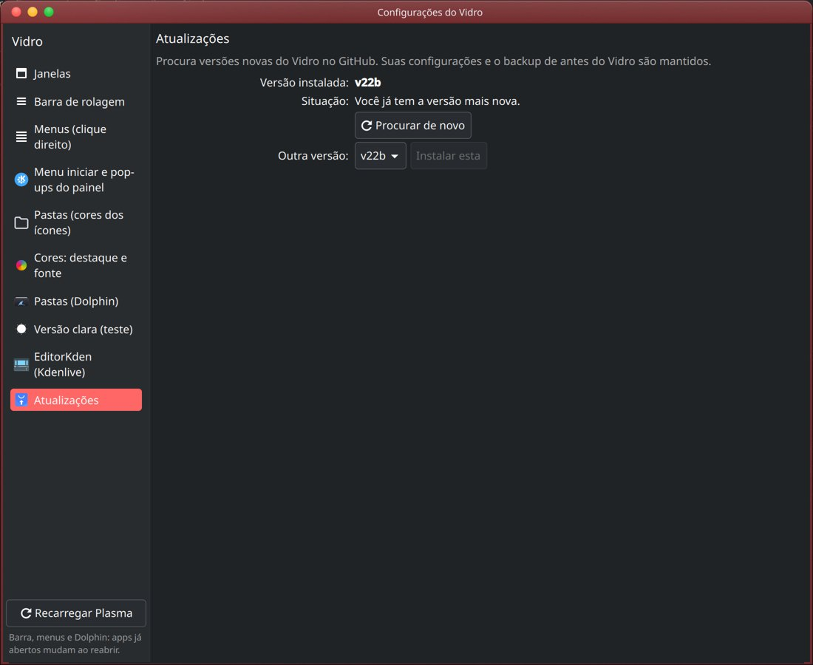

### Também incluído

- **Efeitos do KWin** próprios (abrir/fechar, minimizar, maximizar, mostrar área de trabalho, menus e pop-ups, transparência, barra aparecer/sumir) — aparecem em *Configurações do sistema → Efeitos da área de trabalho*.
- **Estilo do Plasma "Vidro"**, esquema de cores, tema de ícones de pastas e documentos.
- **Telas de bloqueio e de sair** de vidro (Plasma 6.8).
- **Widget de transparência** para o painel e **widget de clima** leve.

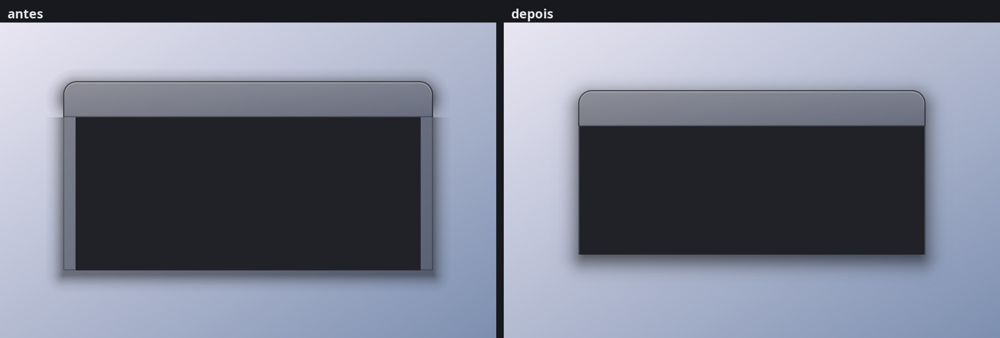

---

## Instalar

Precisa do **KDE Plasma 6** (testado no 6.8, Wayland). Tudo é instalado **só na sua conta** (`~/.local`, `~/.config`), sem `sudo`, e as suas configurações são copiadas antes para `~/.local/share/vidro/backup-<data>`.

### Pacotes pelo terminal (copie e cole)

**Debian / Ubuntu / KDE neon / Kubuntu:**
```bash
curl -fLo /tmp/vidro-kde.deb "$(curl -fsSL https://api.github.com/repos/pznp-ia/vidro-kde/releases/latest | grep -o 'https://[^"]*_amd64\.deb' | head -1)" \
  && sudo apt install /tmp/vidro-kde.deb && vidro-kde-install
```

**Fedora / openSUSE:**
```bash
curl -fLo /tmp/vidro-kde.rpm "$(curl -fsSL https://api.github.com/repos/pznp-ia/vidro-kde/releases/latest | grep -o 'https://[^"]*x86_64\.rpm' | head -1)" \
  && sudo dnf install /tmp/vidro-kde.rpm && vidro-kde-install      # openSUSE: sudo zypper install --allow-unsigned-rpm /tmp/vidro-kde.rpm
```

**Arch / Manjaro / EndeavourOS / CachyOS:**
```bash
mkdir -p /tmp/vidro-kde && cd /tmp/vidro-kde \
  && curl -fLO https://github.com/pznp-ia/vidro-kde/releases/latest/download/PKGBUILD && makepkg -si && vidro-kde-install
```

**Bazzite, Kinoite, Aurora, SteamOS e outros imutáveis:** use a [instalação rápida](#instalação-rápida) (não precisa instalar pacote no sistema).

### Pelo código (qualquer distribuição)

```bash
git clone https://github.com/pznp-ia/vidro-kde.git
cd vidro-kde
bash packaging/install-deps.sh     # dependências (Debian/Ubuntu, Fedora, Arch, openSUSE) — pede sudo
./install.sh
```

O instalador abre uma janela para escolher os extras (animações, telas de bloqueio, barra de rolagem sobreposta, clima, tela de login, NotepadK). Sem janela: `./install.sh --all`, `--only=effects,weather` ou `--skip=sddm,notepadk` (veja `--help`).

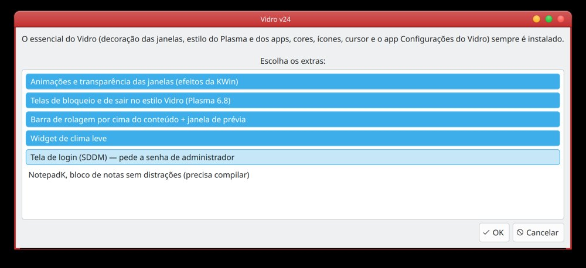

### Pacotes (na página de [Releases](https://github.com/pznp-ia/vidro-kde/releases))

| Distribuição | Arquivo | Comando |
|---|---|---|
| Debian, Ubuntu, KDE neon, Kubuntu | `vidro-kde_<versão>_amd64.deb` | `sudo apt install ./vidro-kde_*_amd64.deb` |
| Fedora, openSUSE | `vidro-kde-<versão>-1.x86_64.rpm` | `sudo dnf install ./vidro-kde-*.rpm` |
| Arch, Manjaro, EndeavourOS, CachyOS | `PKGBUILD` | `makepkg -si` (na pasta do PKGBUILD) |
| Qualquer outra / imutáveis (Bazzite, Kinoite, Aurora, SteamOS) | `vidro-kde-<versão>.tar.gz` | extrair e rodar `./install.sh` |

Os pacotes colocam os arquivos em `/usr/share/vidro-kde`; depois **cada usuário** roda uma vez:

```bash
vidro-kde-install
```

Depois de instalar: **saia e entre de novo** na sessão e adicione o widget **"Transparência das janelas"** ao painel.

**Partes nativas:** a barra de rolagem sobreposta, a janela de prévia e a prévia da tela de login vêm compiladas para o Qt 6.11. Com outro Qt o instalador tenta compilar (`bash packaging/install-deps.sh --build` instala o necessário) e, sem compilador, só pula essas partes — a prévia da tela de login passa a usar o modo de teste do SDDM.

## Atualizar

```bash
vidro-update               # instala a versão mais nova, se houver
vidro-update --check       # só verifica
vidro-update --list        # versões publicadas
vidro-update --version v24 # instala uma versão específica (também serve para voltar)
```

Ou pela aba **Atualizações** do app.

## Linha de comando

```bash
vidro-theme on|off|status                    # liga/desliga o visual (bom para comparar antes e depois)
vidro-opacity 40                             # transparência das janelas, 0 a 100
vidro-config json                            # todas as opções com os valores atuais
vidro-config set Login background video --apply
vidro-config apply                           # reaplica tudo
vidro-profile save|load|list|delete|export|import "Meu visual"
```

Sons (o mesmo que a aba faz):

```bash
python3 ~/.local/share/vidro/modules/sounds.py --import ~/Downloads/tema.tar.gz
python3 ~/.local/share/vidro/modules/sounds.py --export vidro ~/vidro-sons.tar.gz
```

### Login (SDDM) sem o app

```bash
sudo bash components/sddm/install-sddm.sh            # papel de parede Honeywave
sudo bash components/sddm/install-sddm.sh foto.jpg   # ou uma imagem sua
sudo bash components/sddm/undo-sddm.sh               # desfazer
```

### NotepadK

```bash
bash packaging/install-deps.sh --build
bash components/notepadk/install-notepadk.sh
```
Em sistemas imutáveis, rode dentro de um `distrobox`/`toolbox` da mesma versão do sistema.

## Desinstalar

```bash
./uninstall.sh        # pergunta se quer restaurar as configurações de antes
```

---

## Observações

- **Telas de bloqueio e de sair:** no Plasma 6.8 elas ficam no "pacote de shell"; o Vidro usa um pacote próprio (`org.vidro.desktop`). Os arquivos vêm da versão 6.8; **em outras versões o instalador pula essa parte**, porque uma tela de bloqueio quebrada impediria desbloquear o PC.
- **Bazzite e imagens "deck":** o Bazzite desativa o bloqueio de tela e entra direto no modo jogo. Em `extras/bazzite-unlock-screen/` há um script (com `sudo`) que libera o **Win+L**.
- **Vídeo no login:** usa o QtMultimedia do sistema. O vídeo é copiado para o tema; prefira arquivos leves (MP4/WebM).
- **Sons "Vidro":** gerados por síntese no seu PC (`components/settings/sounds/make-sounds.py`), sem amostras de terceiros.
- **A decoração** é gerada por `components/decoration/source/make-decoration.py`; **os ícones** por `components/icons/Vidro/source/make-icons.py`.

## Problemas conhecidos

- Com o efeito de transparência ligado, uma janela minimizada pode continuar aparecendo bem fraca atrás de outras janelas translúcidas (`vidro-opacity 0` resolve).
- O NotepadK aparece agrupado com o Kate na barra de tarefas.

## Mudanças

Veja [CHANGELOG.md](CHANGELOG.md).

## Licença

GPL-3.0-or-later para o código próprio. Partes derivadas do KDE mantêm a licença original: veja [NOTICE.md](NOTICE.md).

<sub>Nas fotos, o nome e a foto do usuário foram trocados por genéricos.</sub>

---

## English summary

**Vidro** ("glass") is a complete translucent look for **KDE Plasma 6** (tested on 6.8, Wayland) plus **Vidro Settings**, an app with one tab per feature, each with a live preview drawn over your wallpaper and on/off switches and sliders for everything:

- **Windows:** glass Aurorae decoration with traffic-light buttons (6 styles, side/order/colors), gaussian shadows, titlebar that follows the wallpaper brightness, per-animation styles for open/close/minimize-to-icon/maximize/show-desktop.
- **Apps:** Union app-style studio, overlay macOS-like scrollbar, menus, accent/font colors, borderless Dolphin, light variant, EditorKden (minimal Kdenlive), **NotepadK** (distraction-free notepad on Kate: centered column, typewriter scrolling, word count, window opacity, transitions).
- **Desktop:** launcher type/options, panel glass, taskbar and clock, **panel show/hide animation studio**, file/sidebar/folder icons, **cursor studio** (generates a full theme; import **SVG or Windows .ico/.cur** and style them with the editor), **mouse/touchpad** options, **login and lock screen studio** (wallpaper gallery, any photo or a **looping video** background, clock, layout, colors; resizable preview window).
- **System:** **system sounds** (all installed themes, the synthesized minimalist "Vidro" set, your own preset, import/export of standard sound themes and loose Windows sound packs), updates.

Quick install (downloads the newest release and opens the installer window): `bash <(curl -fsSL https://github.com/pznp-ia/vidro-kde/releases/latest/download/install-vidro.sh)`. Or install from source with `bash packaging/install-deps.sh && ./install.sh` (per-user, no root, settings backed up), or use the **.deb / .rpm / PKGBUILD / tarball** from Releases and then run `vidro-kde-install` as each user. Update with `vidro-update`. Remove with `./uninstall.sh`.
