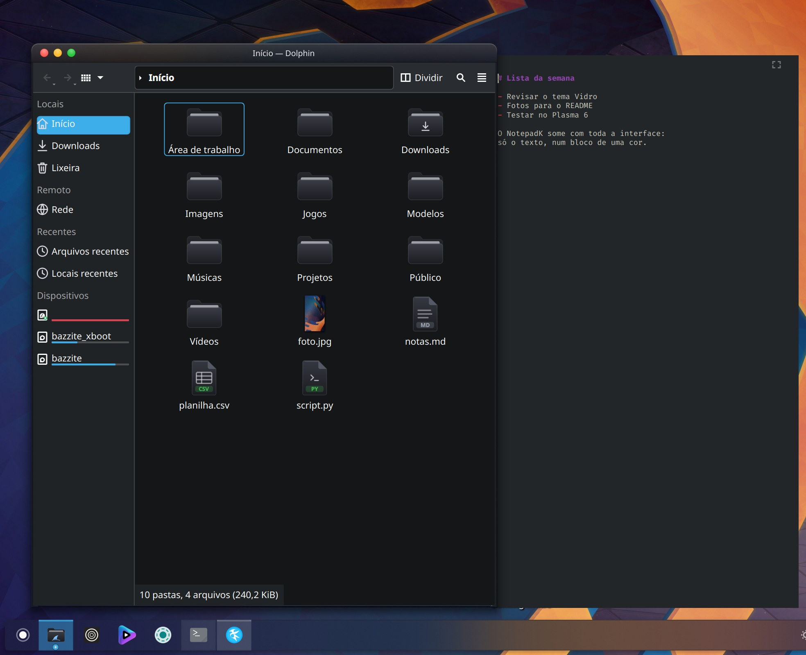
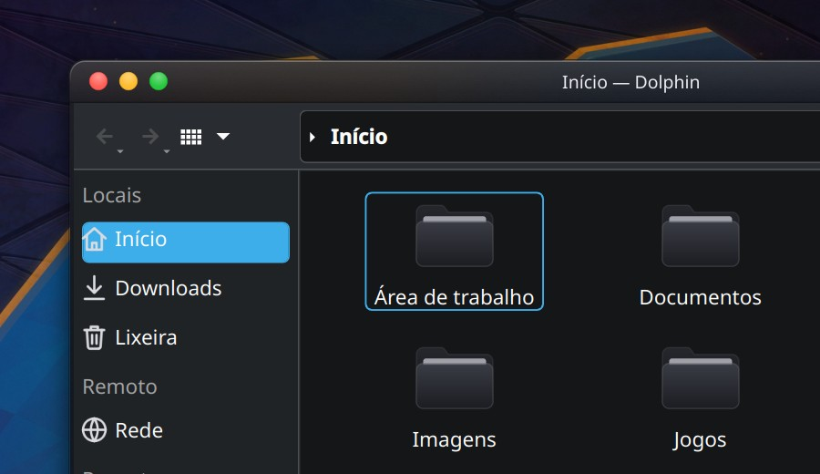
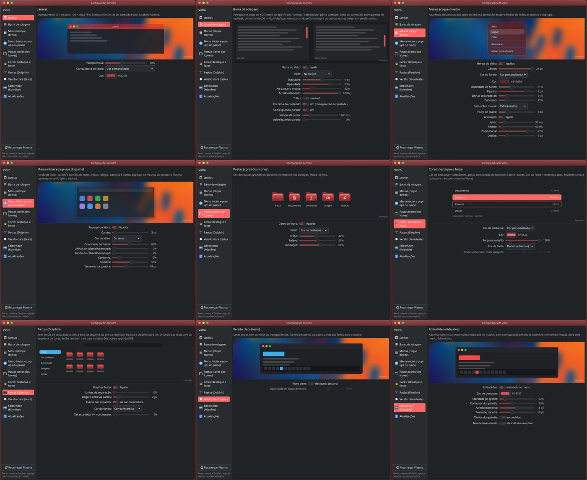
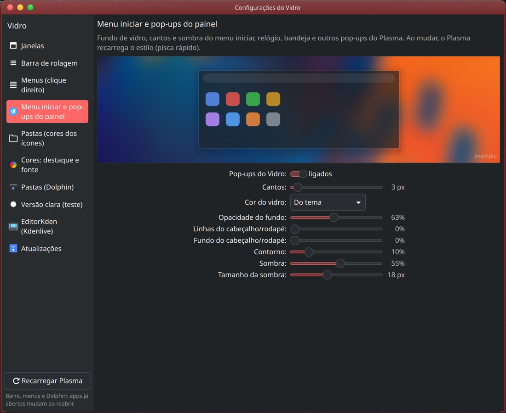
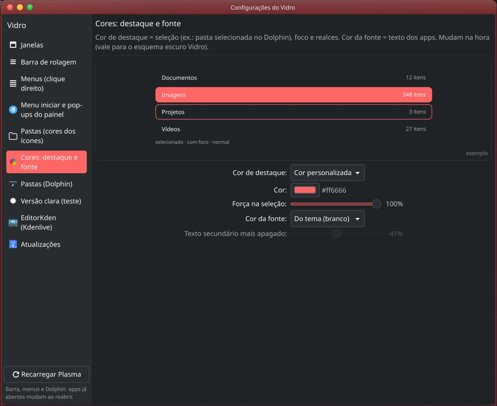
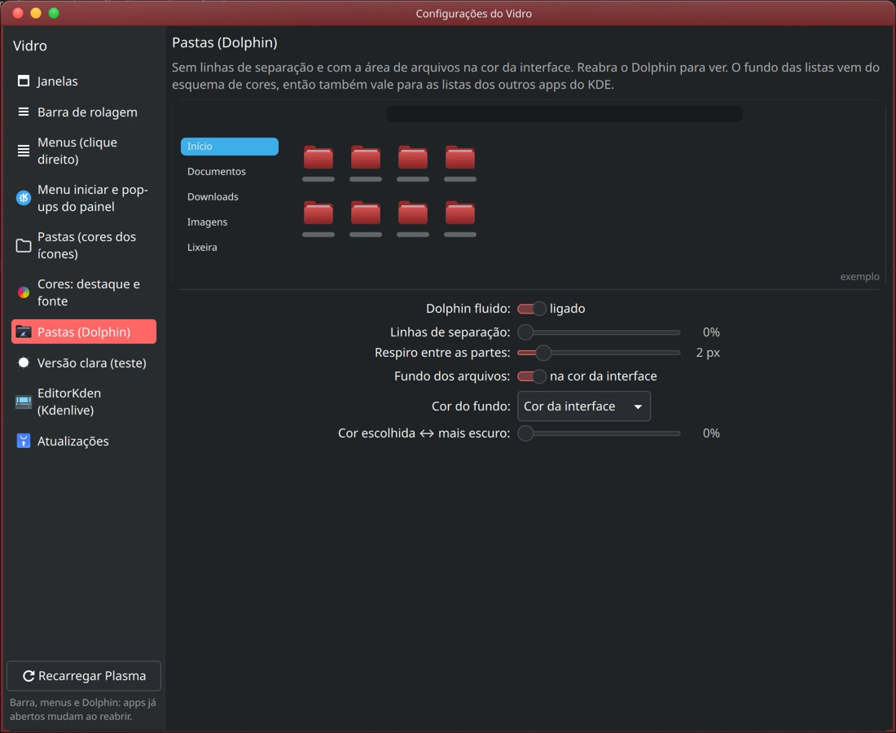
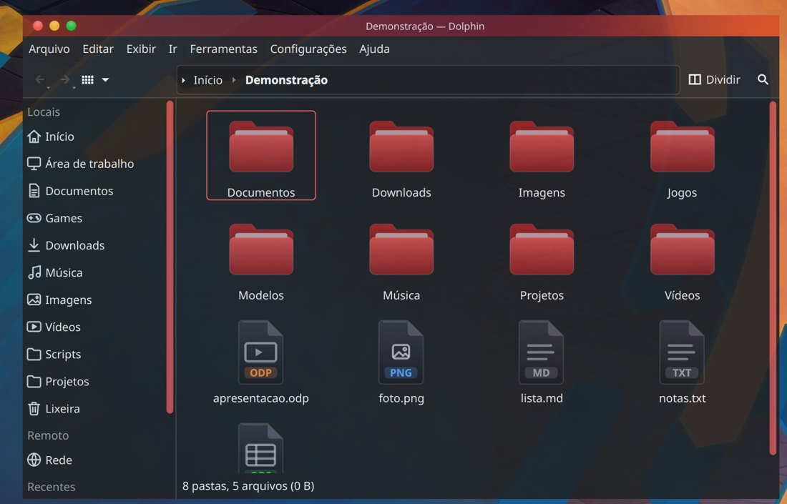
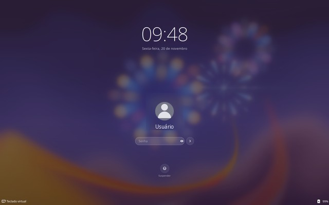
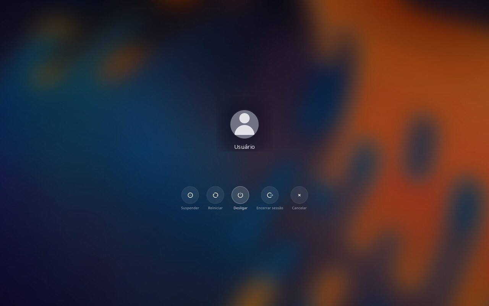

# Vidro

**Um visual de vidro escuro e translúcido para o KDE Plasma 6** — janelas com cantos arredondados e botões no estilo semáforo, sombras suaves, efeitos de abrir, maximizar e minimizar, ícones de pastas minimalistas, telas de bloqueio, de sair e de login combinando, e um bloco de notas sem distrações (NotepadK).

*A glassy, translucent dark look for KDE Plasma 6 — window decoration, shadows, KWin effects, icons, lock/logout/login screens and a distraction-free notepad. English summary at the end.*



---

## O que muda no seu Plasma

| Parte | Como era (Breeze) | Com o Vidro |
|---|---|---|
| **Decoração das janelas** | barra cinza, botões à direita | vidro escuro translúcido, cantos de 12 px, botões fechar/minimizar/maximizar coloridos **à esquerda** |
| **Sombras** | sombra do Breeze | sombra própria, suave e um pouco caída para baixo, sem emendas nos cantos |
| **Cor da barra de título** | fixa | muda sozinha entre escura e clara conforme o brilho do papel de parede |
| **Transparência das janelas** | opaca | ajustável de 0 a 100 por um widget no painel (100 = janela ativa com 75 %, inativas com 60 %) |
| **Maximizar e minimizar** | efeitos padrão | maximizar sem "piscar" a barra de título; minimizar faz a janela **viajar até o próprio ícone** na barra de tarefas |
| **Menus e popups** | deslizam | aparecem com um fade curto |
| **Painel** | opaco ou adaptativo | translúcido |
| **Estilo do Plasma e cores** | Breeze | "Vidro", baseado no Breeze, com painel e diálogos translúcidos |
| **Estilo dos apps** | Breeze | "vidro" para o [Union](https://invent.kde.org/plasma/union): cantos de 8 px e bordas finas (se o Union estiver instalado) |
| **Ícones** | Breeze | pastas e documentos escuros com desenho de linha; ícones de apps continuam coloridos (Tela, se você tiver, ou Breeze) |
| **Tela de bloqueio e de sair** | Breeze | relógio fino, campo de senha de vidro, fundo desfocado do seu papel de parede (Plasma 6.8) |
| **Login (SDDM)** | Breeze | tela de login de vidro (opcional, precisa de `sudo`) |
| **NotepadK** | — | bloco de notas feito sobre o Kate: a janela vira um bloco só da cor do texto, e a interface completa aparece com um clique |
| **Configurações do Vidro** | — | app com uma aba por recurso, cada uma com um exemplo que muda na hora: liga/desliga e ajusta tudo abaixo |
| **Barra de rolagem** | Breeze | fina, de vidro, **por cima do conteúdo** e some quando parada (como no macOS); estilos vidro, neon fino ou cor escolhida |
| **Menus (clique direito)** | Breeze | cantos, opacidade, espaçamento, realce e animação de abrir/fechar ajustáveis |
| **Menu iniciar e pop-ups do painel** | Breeze | fundo de vidro com cantos, contorno e sombra ajustáveis |
| **Cores** | do esquema | cor de destaque e cor da fonte personalizáveis; cores das pastas (grafite, destaque ou qualquer cor) |
| **Dolphin** | linhas entre as partes | sem linhas de separação, área de arquivos na cor da interface |
| **Versão clara** *(teste)* | — | as mesmas transparências com cores claras |
| **EditorKden** | — | atalho para o Kdenlive com visual minimalista (só se o Kdenlive flatpak estiver instalado; o Kdenlive normal não muda) |
| **Atualizações** | — | `vidro-atualizar` (ou a aba no app) baixa as versões novas daqui do GitHub |

### Sombras

A sombra é desenhada pelo próprio tema com um perfil gaussiano (o mesmo de um desfoque de verdade), então as laterais e os cantos se encaixam sem emenda e sem aquela faixa escura dura embaixo.




### Configurações do Vidro

Abra pelo menu de apps (**Configurações do Vidro**) ou com o **clique direito no widget** de transparência. Cada aba tem um exemplo desenhado que muda na hora em que você mexe; os apps já abertos pegam as mudanças de estilo quando são reabertos.



| | |
|---|---|
|  |  |
| **Barra de rolagem:** por cima do conteúdo, some quando parada | **Menus:** cantos, fundo, realce e animação |
|  |  |
| **Menu iniciar e pop-ups do painel** | **Cores das pastas** |
|  |  |
| **Cor de destaque e da fonte** | **Dolphin sem linhas de separação** |

O Dolphin com pastas na cor de destaque, sem linhas entre as partes e com a barra de rolagem fina:



As configurações ficam em `~/.config/vidrorc` e também podem ser mudadas pelo terminal:

```bash
vidro-config json                              # tudo, com os valores padrão
vidro-config set Barra largura 8 --aplicar     # muda e aplica
vidro-config aplicar                           # reaplica tudo
```

### NotepadK

Sem interface, o NotepadK é só o texto num bloco de uma cor, com uma faixa invisível no topo para arrastar a janela (clique duplo maximiza). O botão no canto, ou **Ctrl+Shift+Espaço**, traz de volta a barra de título, os menus, as ferramentas e os números de linha, com uma transição suave.


### Telas de bloqueio e de sair




<sub>Nas fotos, o nome e a foto do usuário foram trocados por genéricos.</sub>

---

## Requisitos

- **KDE Plasma 6** (testado no **6.8**, sessão **Wayland**)
- `python3` (vem em praticamente todas as distribuições)
- Opcionais:
  - **ImageMagick** (`magick`): cor automática da barra de título e fundo desfocado da tela de sair
  - **Union** (`plasma-union`): estilo de apps "vidro"
  - **Tela icon theme** (`Tela-red-dark`): ícones de apps coloridos; sem ele, usa o Breeze Dark
  - Para o NotepadK: Kate e as ferramentas de compilação (veja abaixo)

## Instalar

```bash
git clone https://github.com/pznp-ia/vidro-kde.git
cd vidro-kde
./instalar.sh
```

Tudo é instalado só na sua conta (`~/.local/share`, `~/.local/bin`, `~/.config`), sem `sudo`. Antes de mudar qualquer coisa, o instalador guarda uma cópia das suas configurações em `~/.local/share/vidro/backup-<data>`.

Depois:
- **saia e entre de novo** na sessão (a tela de bloqueio nova vale a partir do próximo login);
- adicione o widget **"Transparência das janelas"** ao painel (clique direito no painel → Adicionar widgets).

### Atualizar

```bash
vidro-atualizar               # instala a versão mais nova, se houver
vidro-atualizar --verificar   # só verifica
vidro-atualizar --lista       # versões publicadas
vidro-atualizar --versao v17  # instala uma versão específica (também serve para voltar)
```

Ou pela aba **Atualizações** do app. A atualização mantém as suas configurações e o backup de antes do Vidro.

### Ligar e desligar

```bash
vidro-tema desligar   # volta ao Breeze Dark (bom para comparar o antes e o depois)
vidro-tema ligar      # volta ao Vidro
vidro-transparencia 40   # transparência de 0 (opaco) a 100
```

### Login (SDDM), opcional

```bash
sudo bash componentes/sddm/instalar-sddm.sh            # usa o papel de parede Honeywave
sudo bash componentes/sddm/instalar-sddm.sh foto.jpg   # ou uma imagem sua
```
Testar sem reiniciar: `sddm-greeter-qt6 --test-mode --theme /usr/local/share/sddm/themes/vidro`.
Desfazer: `sudo bash componentes/sddm/desfazer-sddm.sh`.
O teclado de tela usado no login é o do sistema (por exemplo o plasma-keyboard); o tema não cria um teclado próprio.

### NotepadK, opcional

Instale as dependências de compilação (a lista por distribuição está no topo do script) e rode:

```bash
bash componentes/notepadk/instalar-notepadk.sh
```

Em sistemas imutáveis (Bazzite, Kinoite, Aurora…), rode o script dentro de um `distrobox`/`toolbox` da mesma versão do sistema. O NotepadK usa o Kate do sistema, com configuração própria, então o seu Kate normal não muda.

## Desinstalar

```bash
./desinstalar.sh        # pergunta se quer restaurar as configurações de antes
```

---

## Observações

- **Telas de bloqueio e de sair:** no Plasma 6.8 elas ficam no "pacote de shell", então o Vidro usa um pacote próprio (`org.vidro.desktop`), apontado por uma variável de ambiente do KWin e do serviço de logout. Os arquivos QML vêm da versão 6.8; **em outras versões o instalador pula essa parte**, porque uma tela de bloqueio quebrada impediria desbloquear o PC.
- **Bazzite e outras imagens "deck":** o Bazzite desativa o bloqueio de tela e a troca de usuário (`/etc/xdg/kdeglobals`) e entra direto no modo jogo, sem passar pelo SDDM. Em `extras/bazzite-liberar-bloqueio/` há um script (com `sudo`) que libera o **Win+L**, e um para desfazer.
- **Efeitos do KWin** (`vidro_maximize`, `vidro_minimize`, `vidro_popups`, `vidro_opacity`) são JavaScript e aparecem em *Configurações do sistema → Efeitos da área de trabalho*; dá para desligar cada um ali.
- **A decoração** é gerada por `componentes/aurorae-Vidro/fonte/gerar-vidro.py` (modo `escuro` ou `claro`); edite as constantes no topo para mudar raio, cores ou sombra.
- **Barra de rolagem por cima do conteúdo:** o estilo Union não permite isso só com CSS, então o Vidro tem um pequeno plugin do Qt (`componentes/nativo`, código em `fonte/`). Ele vem compilado para o Qt 6.11; com um Qt mais antigo o instalador tenta compilar (`cmake` + `g++`) e, sem compilador, pula essa parte. Ligar ou desligar vale a partir do próximo login.
- **Os ícones** de pastas e documentos são gerados por `componentes/icones/Vidro/fonte/gerar-icones.py`.

## Problemas conhecidos

- Com o efeito de transparência (`vidro_opacity`) ligado, uma janela minimizada pode continuar aparecendo bem fraca atrás de outras janelas translúcidas. Enquanto não há correção, `vidro-transparencia 0` ou desligar o efeito resolve.
- O NotepadK aparece agrupado com o Kate na barra de tarefas.

## Mudanças (histórico)

Veja [CHANGELOG.md](CHANGELOG.md).

## Licença

GPL-3.0-or-later para o código próprio. Partes derivadas do KDE mantêm a licença original: veja [NOTICE.md](NOTICE.md).

---

## English summary

**Vidro** ("glass" in Portuguese) is a complete dark-glass look for **KDE Plasma 6** (tested on 6.8, Wayland). It includes:
- an Aurorae window decoration with traffic-light buttons on the left and smooth gaussian shadows; the titlebar switches between dark and light to match the wallpaper;
- KWin effects for maximize, minimize-to-icon, popups and adjustable window translucency (with a panel widget);
- a Plasma style, a color scheme, a Union app style and a minimalist folder/document icon theme;
- matching lock, logout and SDDM login screens;
- **NotepadK**, a distraction-free notepad built on Kate (a Kate plugin).
- **Vidro Settings** app (one tab per feature, each with a live preview): overlay macOS-like scrollbar, menu and panel-popup styling, accent/font/folder colors, borderless Dolphin, an experimental light variant and a minimalist Kdenlive launcher (EditorKden).

Update with `vidro-atualizar` (fetches the releases published here; your settings are kept) or from the "Atualizações" tab of the app.

Install with `./instalar.sh` (per-user, no root; your settings are backed up first). Remove with `./desinstalar.sh`. Optional: `sudo bash componentes/sddm/instalar-sddm.sh` for the login screen and `bash componentes/notepadk/instalar-notepadk.sh` for NotepadK. Messages and docs are in Brazilian Portuguese.
